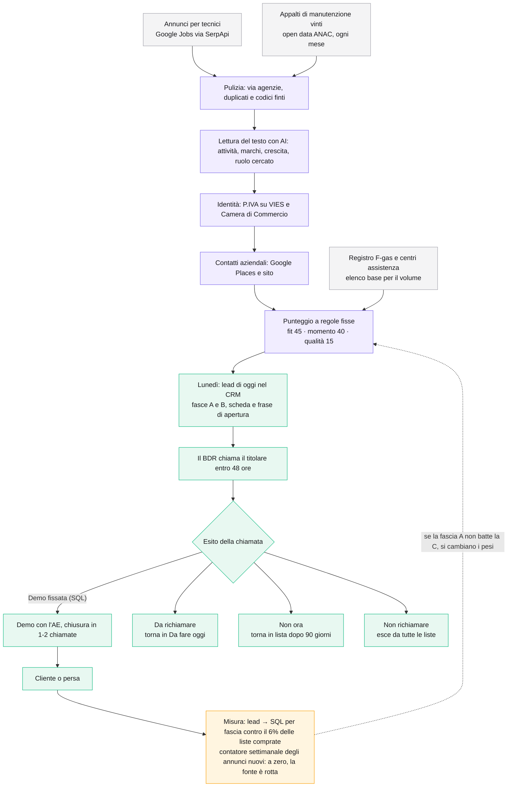

# HeatDesk: business case GTM Engineer

Come trovare installatori e manutentori HVAC italiani nel momento giusto, invece di lavorare liste comprate e vecchie.

HeatDesk è un SaaS immaginario per installatori di caldaie e climatizzatori: preventivi, agenda dei tecnici e contratti di manutenzione. Oggi 8 BDR lavorano liste comprate e convertono il 6% dei lead in SQL. Questo repo contiene la proposta e la prova che funziona su aziende vere.

## Cosa c'è

| Cartella | Contenuto |
|---|---|
| `documento/` | Il business case in 5 pagine: cliente ideale, i 3 segnali, prova di concetto, piano a regime, misura |
| `dati/campione_heatdesk.csv` | 61 aziende italiane reali con un annuncio per tecnici aperto, arricchite e con punteggio. Ogni campo ha la sua fonte. Versione per Excel accanto (separatore `;`) |
| `dati/schede_bdr.md` | Le 19 schede pronte per il BDR (fasce A e B): chi chiamare, perché adesso, frase di apertura |
| `dashboard/index.html` | Demo funzionante del cockpit del BDR. Si apre con un doppio clic, senza installare niente |
| `script/` | Gli script che costruiscono campione, schede e dashboard |
| `schema/flusso.html` | Lo schema della macchina GTM a tutta pagina, da aprire nel browser |
| `dati/lavorazione/` | I file intermedi: annunci raccolti, arricchimento, controllo P.IVA su VIES |

## Il segnale in breve

1. **Annunci di lavoro per tecnici** (segnale n.1, sviluppato qui): chi assume tecnici sta crescendo; chi cerca un'impiegata o un coordinatore ha già il problema di agenda che HeatDesk risolve.
2. **Appalti pubblici di manutenzione vinti** (open data ANAC).
3. **Centri assistenza dei marchi + registro F-gas** (fit, ed elenco base per il volume).

Funnel del campione (15/11/2026): circa 460 annunci → 76 aziende uniche → 61 candidate → 33 nel cliente ideale → 19 in fascia A e B.

## Come gira la macchina

Ogni lunedì, da solo. Grigio le fonti, viola il motore (orchestrato da n8n), verde la vendita, arancio la misura. La freccia tratteggiata è il ritorno: i risultati correggono il punteggio.



## La dashboard

`dashboard/index.html` mostra cosa riceve il BDR ogni lunedì:

Per il BDR:

- **Lead di oggi**: le aziende in fascia A e B, ordinate per punteggio, con il segnale in evidenza e una sessione di chiamate in sequenza.
- **Da fare oggi**: richiami in scadenza, demo da passare all'AE, numeri da correggere, aziende da verificare.
- **Scheda azienda**: perché chiamarli adesso, frase di apertura, punteggio spiegato regola per regola, contatti aziendali e fonti.
- **Chiamata simulata** con esito (demo fissata, da richiamare, ha già un gestionale, non interessato...). In produzione l'esito va nel CRM.
- **Demo fissate**: il passaggio all'AE, da demo fissata a cliente o persa.
- **Non richiamare e in pausa**: chi non va più chiamato e chi torna in lista dopo 90 giorni.
- **Esiti e misura**: conversione lead → SQL per fascia contro il 6% delle liste comprate.

Per il GTM Engineer:

- **Regole di punteggio**: i pesi si cambiano con un cursore e la lista si riordina subito.
- **Mappa dei dati**: per ogni campo, la fonte di oggi, quella a regime e quanto è completo.
- **Decisioni**: le scelte già prese con il motivo, e quelle ancora aperte.
- **Da dove arrivano i lead**: il percorso dal primo annuncio alla scheda.

Le chiamate sono simulate e gli esiti restano solo nel browser di chi la apre.

## Rigenerare tutto

Serve solo Python 3, nessuna libreria esterna.

```bash
python3 -I script/costruisci_campione.py dati/lavorazione   # scrive campione e schede in dati/lavorazione
python3 -I script/verifica_vies.py dati/campione_heatdesk.csv dati/lavorazione/vies.csv   # ricontrolla le P.IVA su VIES
python3 -I script/esporta_dashboard.py .                    # ricostruisce dashboard/index.html dal campione
```

Il punteggio usa regole fisse scritte nel codice: l'AI legge il testo degli annunci, ma non decide l'ordine.

## Dati e privacy

Tutti i dati vengono da fonti pubbliche e gratuite (annunci, siti aziendali, elenchi pubblici, VIES), raccolti il 15/11/2026 a ritmo manuale. Nel campione ci sono solo contatti aziendali: i recapiti personali scritti negli annunci sono per i candidati e sono stati tolti. A regime la raccolta passa da canali autorizzati (vedi il documento, parte 2.4).
